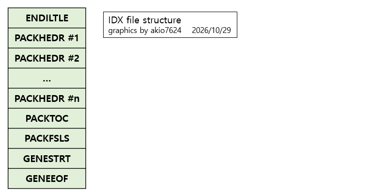

# IDX 파일

## 개요
Artdink 사의 전용 포맷으로 보이는 idx 파일의 바이너리 파일 내부 구조를 분석하여 정리한 문서이다.  
파일 분석에는 사람이 직접 관찰하여 파악한 규칙성과 AI의 도움을 받아 찾아낸 패턴을 바탕으로 실제 몇 개의 게임 파일 샘플에 대해 직접 검토하는 방식을 사용하였다.

## 이름의 유래
apk 파일들의 파일 메타데이터들만 모여있는 것으로 보아 Index에서 따온 것 같다.

## 대략적인 구조

게임에 포함된 여러 개의 apk 파일 각각의 `PACKHEDR`가 나열되며 그 아래로 주요 테이블들이 있다.  
여러 apk의 내용들이 합쳐져서 구성되며, 실제 파일 데이터는 포함하지 않는다.  
엔진은 apk 파일 앞부분의 테이블은 읽지 않고 idx 파일만 읽은 다음, idx 파일에 기록된 오프셋으로 apk 파일의 데이터를 직접 읽는다. 따라서 apk 파일이 변경되면 idx 파일도 반드시 다시 만들어야 한다.

## 상세 구조
테이블이나 정렬 등 기본적인 내용은 [apk 파일의 문서](APK.kr.md)를 참고하며, idx 파일 자체가 apk 파일을 기반으로 생성되는 파일이기에 apk 파일 문서를 먼저 읽는 것이 권장된다.  
각 테이블의 필드 형식 또한 특별한 차이점이 없다면 여기에 중복으로 두지 않을 것이므로 이 경우 apk 파일의 문서를 참고하면 된다.

### ENDILTLE
파일의 시작 부분

### PACKHEDR
게임에 포함되는 각 apk 파일들의 `PACKHEDR` 부분을 그대로 복사해서 나열해두었다.  
기본적으로 필드 값들은 모두 유지되지만, `NAME_IDX`의 경우 idx 파일의 `GENESTRT`에 맞춰서 값이 수정되어 있다.  
`ROOT_FILES_OFS`는 값이 그대로 복사되므로 idx 파일이 아닌 해당 apk 파일 기준의 오프셋임에 주의한다.  
apk별 `PACKHEDR`의 배치 순서는 동작에 영향이 없는 것으로 보이지만 apk 파일 경로 문자열을 기준으로 정렬된 상태로 배치되는 것으로 보인다.

### PACKTOC
각 apk 파일의 `PACKTOC`를 통합한다. 만약 중복되는 경로라면 다른 apk에 있더라도 하나로 합친다.  
예를 들어 `A.apk`에 `data/abc/1.txt`, `data/abc/2.txt`가 있고, `B.apk`에 `data/abc/a.txt`가 있다면 idx의 PACKTOC에서 이 3개의 파일이 모두 `data/abc`아래로 합쳐진다.  
어차피 해당 파일을 실제로 로드할 때는 세그먼트에 기록된 `PACKAGE_NAME_IDX`를 이용해 실제 apk 파일에서 찾아서 열기 때문에 문제 없다.  
두 apk간에 경로와 파일명이 완전히 동일한 파일이 있는 경우는 확인되지 않았으나, 존재하면 파일을 정상적으로 찾는데 문제가 생길 수 있으므로 여기서는 해당 시나리오는 생각하지 않는다.

apk 파일 안에서 `PACKAGE_NAME_IDX`는 항상 자기 자신의 경로인 `0`이지만, idx 파일에서는 해당 파일이 실제로 들어 있는 apk 파일의 경로를 가리킨다. 단, 폴더 세그먼트의 경우 idx 파일에서도 항상 `0`이며 의미 없는 값이다.  
`FILE_ABSOLUTE_OFS`, `FILE_SIZE`, `FILE_ZSIZE`는 apk 파일의 값이 그대로 복사되므로, `FILE_ABSOLUTE_OFS`는 idx 파일이 아닌 `PACKAGE_NAME_IDX`가 가리키는 apk 파일 기준의 오프셋이다.

idx로 가져올 때 변경될 수 있는 필드들은 아래와 같다.  
* PACKTOC의 필드 중
  * `TABLE_SIZE`: 세그먼트들이 합쳐지며 테이블 크기 변동 가능
  * `TOC_SEG_COUNT`: 세그먼트들이 합쳐지며 개수 변동 가능
  * `TOC_SEG_LIST`: 세그먼트들이 합쳐지며 리스트 자체가 변동 가능
* TOC_SEGMENT 필드 중
  * `NAME_IDX`: 뒤에 나오는 `GENESTRT` 테이블이 재작성 되므로 변동 가능
  * `PACKAGE_NAME_IDX`: `GENESTRT` 테이블이 재작성 되고, 파일 세그먼트의 경우 해당 파일이 들어 있는 apk 파일을 가리키게 되므로 변동 가능
  * `ENTRY_INDEX`, `ENTRY_COUNT`: 다른 apk에 동일 경로가 있을 경우 합쳐지면서 변동 가능

### PACKFSLS
각 apk 파일의 `PACKFSLS`를 통합한다.  
FS를 찾을 때 이진 탐색을 하지는 않으므로 세그먼트의 순서는 상관없지만 File Set 이름의 바이트 순서 기준으로 정렬해 배치하는 것으로 보인다.  
`PACKAGE_NAME_IDX`는 해당 File Set이 실제로 들어 있는 apk 파일의 경로를 가리키며, `FS_ABSOLUTE_OFS`와 `FS_HASH`는 apk 파일의 값이 그대로 복사되므로 idx 파일이 아닌 해당 apk 파일 기준의 오프셋과 해시값이다.

idx로 가져올 때 변경될 수 있는 필드들은 아래와 같다.  
* PACKFSLS의 필드 중
  * `TABLE_SIZE`: 세그먼트들이 합쳐지며 테이블 크기 변동 가능
  * `FS_SEG_COUNT`: 세그먼트들이 합쳐지며 개수 변동 가능
  * `FS_SEG_LIST`: 세그먼트들이 합쳐지며 리스트 자체가 변동 가능
* FS_SEGMENT의 필드 중
  * `NAME_IDX`: 뒤에 나오는 `GENESTRT` 테이블이 재작성 되므로 변동 가능
  * `PACKAGE_NAME_IDX`: `GENESTRT` 테이블이 재작성 되고, 해당 File Set이 들어 있는 apk 파일을 가리키게 되므로 변동 가능

### GENESTRT
각 apk 파일의 `GENESTRT`를 하나로 합친다. 같은 문자열은 출처와 상관없이 한 번만 들어간다.  
문자열은 아래 순서로 채워 넣으며, 이미 들어간 문자열이 다시 나오면 건너뛴다.

1. 각 apk 파일의 경로 문자열을 `PACKHEDR`상 순서로 나열
2. root를 의미하는 빈 문자열
3. `PACKTOC`의 파일/폴더 이름. root부터 트리를 따라 내려가며, 폴더를 만나면 그 폴더 안을 끝까지 채운 다음 다음 항목으로 넘어간다.
4. 각 apk의 FS의 이름을 나열한다. 

참고로 FS의 이름을 나열할 때 FS의 탐색 순서는 idx의 `PACKFSLS`에 정렬된 순서가 아닌, 해당 FS이 속하는 apk의 `PACKFSLS`상의 순서대로 접근한다.  
apk는 idx의 `PACKHEDR` 상의 순서대로 탐색한다.  
FS가 포함하는 파일명은 여기에 나열하지 않음에 주의한다.

idx로 가져올 때 변경될 수 있는 필드들은 아래와 같다. 
* GENESTRT의 필드 중
  * `TABLE_SIZE`: 문자열들이 합쳐지며 테이블 크기 변동 가능
  * `STRING_COUNT`: 문자열들이 합쳐지며 개수 변동 가능
  * `STRING_LIST_OFS`: 문자열 개수가 변동되면 `STRING_LIST` 필드의 위에 있는 `STRING_OFS_LIST`의 크기가 달라지므로 오프셋 값 변동 가능
  * `TABLE_SIZE_2`: 이 필드는 `TABLE_SIZE`와 동일한 값이 들어가므로 함께 변동 가능
  * `STRING_OFS_LIST`: 문자열들이 합쳐지며 개수 및 오프셋이 변동 가능
  * `STRING_LIST`: 문자열들이 합쳐지며 변동 가능

### GENEEOF
파일의 끝 부분이다.  
apk 파일과 달리 이 테이블 뒤에는 2048바이트 정렬을 위한 패딩이 없으며, `GENEEOF` 테이블이 끝나는 지점이 파일의 끝이다.