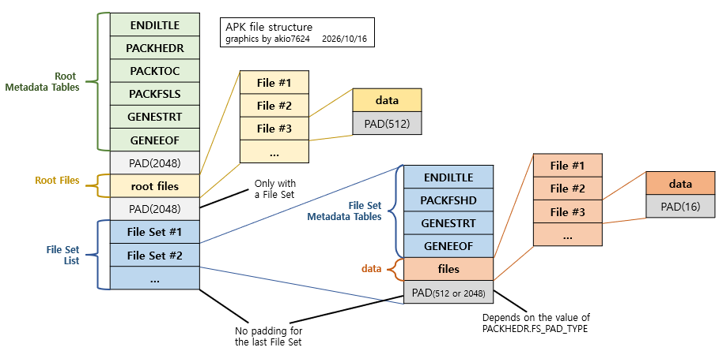
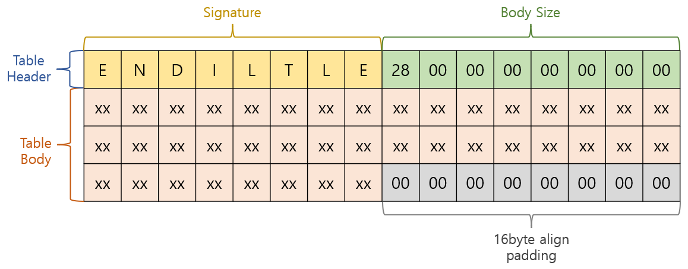

# APK 파일

## 개요
Artdink 사의 전용 포맷으로 보이는 apk 파일의 바이너리 파일 내부 구조를 분석하여 정리한 문서입니다.  
파일 분석에는 사람이 직접 관찰하여 파악한 규칙성과 AI의 도움을 받아 찾아낸 패턴을 바탕으로 실제 몇 개의 게임 파일 샘플에 대해 직접 검토하는 방식을 사용하였습니다.

## 이름의 유래
> [!IMPORTANT]
> 이 문서에서 다루는 APK 파일은 안드로이드 기기에서 애플리케이션을 설치하는 데 흔히 사용되는 APK(Android Application Package) 파일과는 전혀 상관없는 형식입니다.

정확하지는 않지만 Artdink에서 개발한 게임에서 주로 발견되는 것으로 보아 `Artdink PacKage`와 비슷한 의미가 아닐까 추측됩니다.  
이 파일은 인덱스 파일인 `*.idx` 파일과 함께 발견되는 것 같습니다.

## 대략적인 구조

여러 파일들의 구조를 담고 있는 아카이브 형태의 파일이며, 대략적인 모습은 위 이미지와 같습니다.  
기본적으로 필수 테이블들과 root files로 구성되며, 경우에 따라 root files는 생략되고 FS(File Set)만 존재하거나(니세코이 요메이리의 fs.apk 등), root files만 존재하거나(니세코이 요메이리의 all.apk 등), 둘 다 있는 경우(PCSG00214의 data.apk 등) 등 여러 형태로 이루어진 것으로 보입니다.

## 상세 구조
* 각 필드명은 실제 이름이 알려진 정보가 없기 때문에 임의로 적절히 붙였습니다.
* 각 영역의 분류 및 명칭 또한 편의상 임의로 적절히 붙였습니다.
* 이 레포지토리에서는 이 문서에서 정의한 이름을 기준으로 사용합니다.

아래 설명에는 `n바이트에 맞춰 정렬된다`라는 표현이 자주 등장합니다.  
이건 데이터가 끝나는 지점의 오프셋 x가 **x 이상이면서 가장 가까운 n의 배수**가 되도록 남은 공간을 0으로 패딩한다는 의미입니다. (단, 데이터가 끝나는 지점의 오프셋 x가 이미 **n의 배수**이면 패딩을 하지 않습니다)  
데이터의 시작점은 파일의 처음일 수도 있고, 파일 중간의 특정 지점일 수도 있지만 두 경우 모두 시작점은 16의 배수이므로 단순히 파일 전역 오프셋을 기준으로 패딩을 계산해도 문제없습니다. 

* 16바이트에 맞춰 정렬하는데 데이터가 0xC에서 끝났을 때 -> 남은 4바이트를 0으로 채웁니다.
* 512바이트에 맞춰 정렬하는데 데이터가 0x54DC에서 끝났을 때 -> 남은 292바이트를 0으로 채웁니다.

또한 아래와 같은 구조를 `테이블`이라고 부르겠습니다.

테이블은 16바이트의 `Table Header`와 가변 길이의 `Table Body`로 이루어지며, `Table Body`는 없는 경우도 있습니다.  
`signature`의 경우 ASCII 문자열이며, 만약 문자열의 길이가 `8` 미만인 경우 남은 바이트는 `0x0(null)`이 아닌 `0x20(space)`로 채워집니다.  
`TABLE_SIZE`의 경우 헤더 16바이트를 제외한 테이블의 나머지 영역의 크기(패딩이 있다면 패딩 크기도 포함)를 나타내는 `uint64` 타입 정수이며, `Table Body`가 없는 경우에는 `0`입니다.  
만약 테이블의 마지막 부분이 16바이트에 정렬되어 있지 않다면 `0`으로 채워 정렬합니다. 일부 테이블은 마지막에 가변 길이 요소를 가지며, 이 요소 자체의 패딩에 의해 정렬된 경우에는 테이블을 추가로 정렬해 줄 필요는 없습니다.

파일 내에서 주요 요소들의 정렬 단위는 다음과 같습니다.

|                  대상                  |            정렬 단위             | 비고                                                                                |
|:------------------------------------:|:----------------------------:|:------------------------------------------------------------------------------------|
|              각 테이블의 끝               |             16바이트            | 가변 길이 요소 자체의 패딩으로 이미 정렬된 경우에는 추가 패딩이 없습니다.           |
|            `Root Files` 시작           |            2048바이트           | `GENEEOF` 테이블이 끝난 지점부터 패딩합니다.                                        |
|        `Root Files`의 각 파일          |             512바이트            |                                                                                     |
|   첫 `File Set`의 `ENDILTLE` 시작      |            2048바이트           | `File Set`이 1개 이상일 때만 `Root Files` 다음에 패딩합니다.                        |
|           각 `File Set` 전체           | 2048바이트 또는 512바이트 | `PACKHEDR.FS_PAD_TYPE`에 따라 결정되며, 마지막 `File Set`은 패딩하지 않아도 됩니다. |
|        `File Set`의 `files` 영역 내 각 파일        |             16바이트            |                                                                                     |

### Root Metadata Tables
필수로 포함되어야 하는 테이블들입니다.

#### ENDILTLE
|    이름    | 자료형 | 크기/길이 | 설명                                                                                                                                                                              |
|:----------:|:------:|:----:|:----------------------------------------------------------------------------------------------------------------------------------------------------------------------------------|
| SIGNATURE  | char[] |  8   | 파일의 엔디안 정보를 나타냅니다. `ENDILTLE`면 리틀 엔디언, `ENDIBIGE`면 빅 엔디언임을 의미합니다. 다만 `apk`, `idx` 파일 중 빅 엔디안인 경우는 현재까지 확인되지 않고 있습니다. |
| TABLE_SIZE | uint64 |  8   | 이 테이블은 Body를 가지지 않으므로 항상 `0`입니다.                                                                                                                                  |

#### PACKHEDR
의미: `PACK HEaDer`

|    이름    | 자료형 | 크기/길이 | 설명                                                                                                                                                           |
|:----------:|:------:|:----:|:---------------------------------------------------------------------------------------------------------------------------------------------------------------|
|  SIGNATURE  | char[] |  8   | 테이블 시그니처로, 항상 `PACKHEDR`입니다.                                                                                                                      |
| TABLE_SIZE | uint64 |  8   | Body의 크기로, 항상 `32`입니다.                                                                                                                                |
| unknown_1 | uint32 |  4   | 파일 버전으로 추측되지만 정확한 용도는 불명이며, 항상 `65536`입니다.                                                                                           |
| NAME_IDX | uint32 |  4   | 이 패키지 파일의 이름을 가리키는 인덱스입니다. `GENESTRT.STRING_LIST`의 인덱스를 의미합니다. ex) `data/data.apk`                                         |
| ROOT_FILES_OFS | uint32 |  4   | Root Files 영역이 시작되는 지점의 절대 오프셋입니다. 엔진이 실제로 이 값을 읽고 사용하는지는 불명입니다.                                                    |
| FS_PAD_TYPE | uint32 |  4   | File Set의 패딩을 몇 바이트로 정렬할지 지정하는 플래그입니다. File Set이 없어도 이 값은 지정될 수 있습니다. - `1`: 2048바이트 정렬 - `2`: 512바이트 정렬 |
| HASH | byte[] |  16  | 아카이브의 무결성 검증을 위한 MD5 해시값으로 추정되나 엔진이 실제로 값을 읽는 것 같지는 않아 보입니다. 임의의 값으로 채워 넣어도 문제 없습니다.                |

#### PACKTOC
의미: `PACK Table Of Content`

|    이름    | 자료형 | 크기/길이 | 설명                                                                                                                                                                                                                  |
|:----------:|:------:|:----:|:----------------------------------------------------------------------------------------------------------------------------------------------------------------------------------------------------------------------|
|  SIGNATURE  | char[] |  8   | 테이블 시그니처로, 항상 `PACKTOC `입니다. 마지막 글자는 null이 아닌 **공백**입니다.                                                                                                                                   |
| TABLE_SIZE | uint64 |  8   | Body의 크기로, 각 필드의 크기(바이트)를 아래 식에 넣어 계산할 수 있습니다. `align16(sizeof(TOC_SEG_SIZE) + sizeof(TOC_SEG_COUNT) + sizeof(TOC_SEG_LIST_OFS) + sizeof(unknown_1) + (TOC_SEG_SIZE * TOC_SEG_COUNT))` |
| TOC_SEG_SIZE | uint32 |  4   | `TOC_SEGMENT` 한 개의 크기를 나타내며, `40`으로 고정값입니다.                                                                                                                                                          |
| TOC_SEG_COUNT | uint32 |  4   | `TOC_SEG_LIST`에 포함된 세그먼트 개수를 나타냅니다.                                                                                                                                                                                     |
| TOC_SEG_LIST_OFS | uint32 |  4   | 테이블 Body를 기준점으로 하는 `TOC_SEG_LIST` 필드의 시작 오프셋입니다.  `TOC_SEG_SIZE`, `TOC_SEG_COUNT`, `TOC_SEG_LIST_OFS`, `unknown_1` 필드는 모두 고정 길이이므로 이 필드의 값은 항상 `16`입니다.                |
| unknown_1 | uint32 |  4   | 용도 불명의 필드이며, 값은 항상 `0`입니다.                                                                                                                                                                            |
| TOC_SEG_LIST | TOC_SEGMENT[] |  TOC_SEG_COUNT   | `TOC_SEGMENT`의 리스트로 구성된 세그먼트 리스트입니다. 각 세그먼트가 `TOC_SEG_COUNT`개만큼 나열되어 있습니다.                                                                                                     |

##### TOC_SEGMENT
|    이름    | 자료형 | 크기/길이 | 설명                                                                                                                                                                                                                                                                                                                                             |
|:----------:|:------:|:----:|:-------------------------------------------------------------------------------------------------------------------------------------------------------------------------------------------------------------------------------------------------------------------------------------------------------------------------------------------------|
|  IDENTIFIER  |  uchar  |  1   | 세그먼트가 의미하는 데이터의 종류를 지정하는 플래그입니다. -`0`: 파일 -`1`: 디렉토리                                                                                                                                                                                                                                                       |
|  COMPRESS_TYPE  | uchar |  1   | 세그먼트의 데이터가 파일일 때 압축 여부를 지정하는 플래그입니다. `IDENTIFIER`가 `1`이면 이 필드도 항상 `0`입니다. `IDENTIFIER`가 `0`이며, 데이터가 zlib으로 압축되어 있다면 이 필드의 값은 `2`입니다. 압축이 안 되어 있다면 `0`입니다. 즉, 이 필드의 값이 `0`이라는 것은 세그먼트가 디렉토리이거나 압축이 되지 않은 파일이라는 뜻입니다. |
|  unknown_1  | uint16  |  2   | 용도 불명의 필드이며, 값은 항상 `0`입니다.                                                                                                                                                                                                                                                                                                       |
|  NAME_IDX  |  uint32  |  4   | 세그먼트가 의미하는 파일/폴더의 이름이며, `GENESTRT.STRING_LIST`의 인덱스를 의미합니다. 이때 문자열은 중간 경로 없이 항상 마지막 파일/폴더의 이름만 가집니다.                                                                                                                                                                                |
|  PACKAGE_NAME_IDX  |  uint32  |  4   | 세그먼트가 의미하는 파일/폴더가 속한 apk 파일의 경로를 의미합니다. ex) `data/data.apk` 기본적으로 현재 apk 파일의 이름이 들어가는 것으로 보이며, 만약 루트 파일이 다른 apk에 들어있는 경우 해당 apk의 이름이 됩니다(예를 들면 PCSG00214의 경우)                                                                                              |
|  unknown_2  |  uint32  |  4   | 용도 불명의 필드이며, 값은 항상 `0`입니다.                                                                                                                                                                                                                                                                                                       |

여기까지가 세그먼트의 공통 필드이며, 다음 24바이트는 `IDENTIFIER` 필드의 값에 따라 다르게 읽어야 합니다.  

**IDENTIFIER == 1인 경우(폴더)**

|    이름    | 자료형 | 크기/길이 | 설명                                                                                                                  |
|:----------:|:------:|:----:|:----------------------------------------------------------------------------------------------------------------------|
| ENTRY_INDEX | uint32 |  4   | 폴더에 속하는 폴더/파일들의 세그먼트 나열이 시작되는 `TOC_SEGMENT[]` 상의 인덱스입니다. 자세한 설명은 표 아래 참고 |
| ENTRY_COUNT | uint32 |  4   | 폴더에 속하는 폴더/파일들의 개수입니다.                                                                               |
|  unused_1  | uint64 |  8   | 폴더인 경우 사용하지 않는 필드이며, 값은 항상 `0`입니다.                                                              |
|  unused_2  | uint64  |  8   | 폴더인 경우 사용하지 않는 필드이며, 값은 항상 `0`입니다.                                                              |

만약 현재 세그먼트가 `font`라는 폴더를 가리키며, `ENTRY_INDEX`가 `150`, `ENTRY_COUNT`가 `3`이라면, `PACKTOC.TOC_SEGMENT[]`의 `150`번 요소부터 `3`개의 세그먼트가 `font` 폴더 안에 있는 요소들이라는 의미입니다.  

**IDENTIFIER == 0인 경우(파일)**

|    이름    | 자료형 | 크기/길이 | 설명                                                                                                       |
|:----------:|:------:|:----:|:-----------------------------------------------------------------------------------------------------------|
| FILE_ABSOLUTE_OFS | uint64 |  8   | 세그먼트가 가리키는 파일의 실제 바이너리 데이터의 절대 오프셋입니다.                                       |
|  FILE_SIZE  | uint64 |  8   | `COMPRESS_TYPE`가 `0`일 경우 파일의 크기(바이트)입니다. 압축된 파일이라면 이 필드는 `0`입니다.             |
|  FILE_ZSIZE  | uint64  |  8   | `COMPRESS_TYPE`가 `2`일 경우 압축된 파일의 크기(바이트)입니다. 압축이 안 된 파일이라면 이 필드는 `0`입니다. |

> [!IMPORTANT]
> 엔진은 이진탐색으로 파일을 찾으므로 세그먼트는 제대로 정렬되어 있어야 합니다.

엔진은 이진 탐색을 이용해 세그먼트 리스트에서 특정 파일의 정보를 찾습니다.  
내부적으로는 `idx` 파일에서 조회하지만, idx 파일의 세그먼트 정보도 이 테이블의 세그먼트 정보를 바탕으로 생성되는 것이므로 여기서 정렬을 제대로 해야합니다.  
먼저 첫번째 세그먼트는 빈 문자열인 `NAME_IDX=1`로 지정된 루트 세그먼트입니다. `ENTRY_INDEX`는 `1`입니다.  
이후 각 깊이별로 폴더/파일 구분 없이 오직 이름만 기준으로 오름차순으로 세그먼트 리스트에 넣은 다음, 그중 폴더가 있다면 각 폴더에 대해 한 단계 들어가서 동일하게 세그먼트를 오름차순으로 배치합니다.  
단계 이동 시에는 `ENTRY_INDEX`를 보고 이동하므로 폴더의 방문 순서는 꼭 정렬된 순서일 필요는 없어 보이나, 굳이 임의의 순서로 배치할 필요도 없어 보입니다.  
하지만 최소한 같은 부모의 파일/폴더 간에는 이름 기준 정렬이 되어 있어야 합니다.

#### PACKFSLS
의미: `PACK File Set LiSt`

|    이름    |    자료형    |     크기     | 설명                                                                                                                                                                                                             |
|:----------:|:------------:|:------------:|:-----------------------------------------------------------------------------------------------------------------------------------------------------------------------------------------------------------------|
|  SIGNATURE  |    char[]    |      8       | 테이블 시그니처로, 항상 `PACKFSLS`입니다.                                                                                                                                                                        |
| TABLE_SIZE |    uint64    |      8       | Body의 크기로, 각 필드의 크기(바이트)를 아래 식에 넣어 계산할 수 있습니다. `align16(sizeof(FS_SEG_COUNT) + sizeof(FS_SEG_SIZE) + sizeof(FS_SEG_LIST_OFS) + sizeof(unknown_1) + (FS_SEG_SIZE * FS_SEG_COUNT))` |
| FS_SEG_COUNT |    uint32    |      4       | `FS_SEG_LIST`에 포함된 세그먼트 개수를 나타냅니다.                                                                                                                                                                |
| FS_SEG_SIZE |    uint32    |      4       | `FS_SEGMENT` 한 개의 크기를 나타내며, `40`으로 고정값입니다.                                                                                                                                                                     |
| FS_SEG_LIST_OFS |    uint32    |      4       | 테이블 Body를 기준점으로 하는 `FS_SEG_LIST` 필드의 시작 오프셋입니다. `FS_SEG_COUNT`, `FS_SEG_SIZE`, `FS_SEG_LIST_OFS`, `unknown_1` 필드는 모두 고정 길이이므로 이 필드의 값은 항상 `16`입니다.                |
| unknown_1 |    uint32    |      4       | 용도 불명의 필드이며, 값은 항상 `0`입니다.                                                                                                                                                                       |
| FS_SEG_LIST | FS_SEGMENT[] | FS_SEG_COUNT | `FS_SEGMENT`의 리스트로 구성된 세그먼트 리스트입니다. 각 세그먼트가 `FS_SEG_COUNT`개만큼 나열되어 있습니다.                                                                                                  |
| PACKFSLS_PAD |      -       |      -       | 테이블의 끝이 16바이트에 정렬되도록 나머지 공간을 `0`으로 패딩하는 부분입니다                                                                                                                                    |

> [!NOTE]
> `PACKTOC`과 달리 세그먼트 개수를 나타내는 `FS_SEG_COUNT`가 세그먼트 크기를 나타내는 `FS_SEG_SIZE`보다 먼저 위치합니다.

##### FS_SEGMENT
|    이름    | 자료형 | 크기/길이 | 설명                                                                                                                                                              |
|:----------:|:------:|:----:|:------------------------------------------------------------------------------------------------------------------------------------------------------------------|
|  NAME_IDX  | uint32 |  4   | 세그먼트가 의미하는 파일/폴더의 이름이며, `GENESTRT.STRING_LIST`의 인덱스를 의미합니다. 이때 문자열은 중간 경로 없이 항상 마지막 파일/폴더의 이름만 가집니다. |
|  PACKAGE_NAME_IDX  | uint32 |  4   | 세그먼트가 의미하는 파일/폴더가 속한 apk 파일의 경로를 의미합니다. ex) `data/data.apk` `TOC_SEGMENT.PACKAGE_NAME_IDX`와 설명은 동일합니다.                  |
|  FS_ABSOLUTE_OFS  | uint64 |  8   | 세그먼트가 의미하는 File Set이 위치하는 파일상 절대 오프셋 값입니다.                                                                                              |
|  FS_SIZE  | uint64 |  8   | 세그먼트가 의미하는 File Set의 전체 크기(바이트)입니다.                                                                                                           |
|  FS_HASH  | byte[] |  16  | File Set 전체에 대한 MD5 해시 결과입니다. 범위: `md5([FS_ABSOLUTE_OFS, FS_ABSOLUTE_OFS+FS_SIZE))`                                                              |

#### GENESTRT
의미: `GENEral STRing Table`

|    이름    |  자료형  |     크기     | 설명                                                                                                                                                                                                                            |
|:----------:|:--------:|:------------:|:--------------------------------------------------------------------------------------------------------------------------------------------------------------------------------------------------------------------------------|
|  SIGNATURE  |  char[]  |      8       | 테이블 시그니처로, 항상 `GENESTRT`입니다.                                                                                                                                                                                       |
| TABLE_SIZE |  uint64  |      8       | Body의 크기로, 각 필드의 크기(바이트)를 아래 식에 넣어 계산할 수 있습니다. `align16(align16(16 + (4 * STRING_COUNT)) + arrsize_byte(STRING_LIST))` (`arrsize_byte(STRING_LIST)`는 `STRING_LIST` 전체의 바이트 크기입니다) |
| STRING_COUNT |  uint32  |      4       | `STRING_LIST`가 포함하는 문자열의 개수입니다.                                                                                                                                                                                   |
| STRING_OFS_LIST_OFS |  uint32  |      4       | 테이블 Body를 기준점으로 하는 `STRING_OFS_LIST` 필드의 시작 오프셋입니다. `STRING_COUNT`, `STRING_OFS_LIST_OFS`, `STRING_LIST_OFS`, `TABLE_SIZE_2` 필드는 모두 고정 길이이므로 이 필드의 값은 항상 `16`입니다.               |
| STRING_LIST_OFS |  uint32  |      4       | 테이블 Body를 기준점으로 하는 `STRING_LIST` 필드의 시작 오프셋입니다. `STRING_OFS_LIST`와 `STRING_OFS_LIST_PAD`를 건너뛴 위치입니다 계산: `align16(16 + (4 * STRING_COUNT))`                                               |
| TABLE_SIZE_2 |  uint32  |      4       | `TABLE_SIZE`와 동일한 값을 가집니다. 실제로 사용되는 필드는 아닌 것으로 보이며 다만 값만 동일하게 맞춰두면 될 것 같습니다.                                                                                                    |
| STRING_OFS_LIST | uint32[] | STRING_COUNT | `i`번째 문자열의 위치를 `STRING_LIST`의 시작점을 기준으로 몇 바이트 떨어진 곳에 있는지 나타내는 오프셋의 리스트입니다. `STRING_LIST`의 배열 인덱스가 **아님**에 주의합니다.                                                  |
| STRING_OFS_LIST_PAD |    -     |      -       | `STRING_OFS_LIST`의 끝이 16바이트에 정렬되도록 나머지 공간을 `0`으로 패딩하는 부분입니다.                                                                                                                                       |
| STRING_LIST | string[] | STRING_COUNT | `null`로 끝나는 UTF-8 문자열들의 나열입니다.                                                                                                                                                                                    |
| STRING_LIST_PAD |    -     |      -       | 테이블의 끝(`STRING_LIST`의 끝)이 16바이트에 정렬되도록 나머지 공간을 `0`으로 패딩하는 부분입니다.                                                                                                                              |

#### GENEEOF
의미: `GENEral End Of File`

|    이름    | 자료형 | 크기/길이 | 설명                                                                                                                                                                   |
|:----------:|:------:|:----:|:-----------------------------------------------------------------------------------------------------------------------------------------------------------------------|
| SIGNATURE  | char[] |  8   | 테이블 시그니처로, 항상 `GENEEOF `입니다. 마지막 글자는 null이 아닌 **공백**입니다. `Root Metadata Tables` 영역이 끝났음을 알리는 빈 테이블입니다. 이 아래부터 `Root Files`와 `File Set List`가 나옵니다. |
| TABLE_SIZE | uint64 |  8   | 이 테이블은 Body를 가지지 않으므로 항상 `0`입니다.                                                                                                                     |

#### Root Metadata Padding
`Root Files`가 시작되는 영역의 절대 오프셋이 `2048`의 배수가 되도록 `GENEEOF` 테이블이 끝난 지점부터 `0`으로 패딩하는 영역입니다. 

### Root Files
루트 파일이 존재할 경우 각 파일들이 나열되는 영역입니다.  
각 파일은 512바이트에 맞춰 정렬됩니다.

#### Root Files Padding
만약 `File Set`이 1개 이상 존재한다면 첫 File Set의 `ENDILTLE` 테이블의 시작 오프셋이 `2048`의 배수가 되도록 `Root Files`가 끝난 지점부터 `0`으로 패딩하는 영역입니다.
`File Set`이 없는 경우에는 추가적인 정렬이 필요 없습니다.

### File Set List
각 File Set은 패딩을 가지며, `PACKHEDR.FS_PAD_TYPE` 필드에 따라 FS 전체를 2048 혹은 512바이트에 맞게 `0`으로 패딩을 합니다.  
다만 마지막 File Set의 경우에는 패딩을 하지 않아도 됩니다.

#### ENDILTLE
|    이름    | 자료형 | 크기/길이 | 설명                                                                                                                                                                                                                                                                                                        |
|:----------:|:------:|:----:|:------------------------------------------------------------------------------------------------------------------------------------------------------------------------------------------------------------------------------------------------------------------------------------------------------------|
| SIGNATURE  | char[] |  8   | 파일의 엔디안 정보를 나타냅니다. `ENDILTLE`면 리틀 엔디언, `ENDIBIGE`면 빅 엔디언임을 의미합니다. 다만 빅 엔디안인 경우는 현재까지 확인되지 않고 있습니다.                                                                                                                                               |
| TABLE_SIZE | uint64 |  8   | 이 테이블은 Body를 가지지 않으므로 항상 `0`입니다.                                                                                                                                                                                                                                                          |

#### PACKFSHD
의미: `PACK File Set HeaDer`

|      이름       |    자료형     | 크기/길이 | 설명                                                                                                                                                                                                         |
|:---------------:|:-------------:|:----:|:-------------------------------------------------------------------------------------------------------------------------------------------------------------------------------------------------------------|
|    SIGNATURE    |    char[]     |  8   | 테이블 시그니처로, 항상 `PACKFSHD`입니다.                                                                                                                                                                    |
|   TABLE_SIZE    |    uint64     |  8   | Body의 크기로, 각 필드의 크기(바이트)를 아래 식에 넣어 계산할 수 있습니다. `align16(sizeof(unknown_1) + sizeof(FILE_SEG_SIZE) + sizeof(FILE_SEG_COUNT) + sizeof(FS_FILE_SEG_OFS) + sizeof(GENESTRT_OFS) + sizeof(unknown_2) + sizeof(unknown_3) + sizeof(unknown_4) + (FILE_SEG_SIZE * FILE_SEG_COUNT))` |
|    unknown_1    |    uint32     |      4       | 용도 불명의 필드이며, 값은 항상 `65536`입니다.                                                                                                                                                               |
|  FILE_SEG_SIZE  |    uint32     |      4       | `FS_FILE_SEG` 한 개의 크기를 나타내며, `32`로 고정값입니다.                                                                                                                                                |
| FILE_SEG_COUNT  |    uint32     |      4       | `FS_FILE_SEG_LIST`에 포함된 세그먼트 개수를 나타냅니다.                                                                                                                                                      |
| FS_FILE_SEG_OFS |    uint32     |      4       | `PACKFSHD.unknown_1`의 시작점을 기준으로 `FS_FILE_SEG_LIST`의 시작 지점이 몇 바이트 떨어진 곳에 있는지 나타내는 오프셋입니다. 값은 항상 `32`입니다.                                                   |
|  GENESTRT_OFS   |    uint32     |      4       | 현재 FS의 처음을 기준으로 이 FS의 `GENESTRT` 테이블의 시작 오프셋입니다. 실제로 사용되는 값은 아닌 것으로 보입니다. 계산식은 다음과 같습니다: `sizeof(ENDILTLE) + sizeof(PACKFSHD) + sizeof(GENESTRT)` |
|    unknown_2    |    uint32     |      4       | 용도 불명의 필드이며, 값은 항상 `0`입니다.                                                                                                                                                                   |
|    unknown_3    |    uint32     |      4       | 용도 불명의 필드이며, 값은 항상 `0`입니다.                                                                                                                                                                   |
|    unknown_4    |    uint32     |      4       | 용도 불명의 필드이며, 값은 항상 `0`입니다.                                                                                                                                                                   |
|    FS_FILE_SEG_LIST    | FS_FILE_SEG[] |      FILE_SEG_COUNT       | `FS_FILE_SEG`의 리스트로 구성된 세그먼트 리스트입니다. 각 세그먼트가 `FILE_SEG_COUNT`개만큼 나열되어 있습니다.                                                                                             |
| PACKFSHD_PAD |       -       |      -       | 테이블의 끝이 16바이트에 정렬되도록 나머지 공간을 `0`으로 패딩하는 부분입니다.                                                                                                                               |

##### FS_FILE_SEG
|     이름      | 자료형 | 크기/길이 | 설명                                                                                                                                                                                                                                                                                         |
|:-------------:|:------:|:---------:|:---------------------------------------------------------------------------------------------------------------------------------------------------------------------------------------------------------------------------------------------------------------------------------------------|
|   NAME_IDX    | uint32 |     4     | 세그먼트가 의미하는 파일의 이름이며, 현재 FS의 `GENESTRT.STRING_LIST`내의 인덱스를 의미합니다. 이때 문자열은 중간 경로 없이 항상 마지막 파일의 이름만 가집니다.                                                                                                                          |
| COMPRESS_TYPE |  uchar  |     1     | 파일의 압축 여부를 지정하는 플래그입니다. 데이터가 zlib으로 압축되어 있다면 이 필드의 값은 `2`입니다. 압축이 안 되어 있다면 `0`입니다. |
|   unknown_1   | uchar  |     1     | 용도 불명의 필드이며, 값은 항상 `0`입니다.                                                                                                                                                                                                                                                   |
|   unknown_2   | uchar |     1     | 용도 불명의 필드이며, 값은 항상 `0`입니다.                                                                                                                                                                                                                                                   |
|   unknown_3   | uchar |     1     | 용도 불명의 필드이며, 값은 항상 `0`입니다.                                                                                                                                                                                                                                                   |
|   FILE_OFS    | uint64 |  8   | `files` 영역의 시작점을 기준으로 하는 해당 파일이 시작하는 오프셋입니다.                                                                                                                                                                                                                     |
|   FILE_SIZE   | uint64 |  8   | `COMPRESS_TYPE`가 `0`일 경우 파일의 크기(바이트)입니다. 압축된 파일이라면 이 필드는 `0`입니다.                                                                                                                                                                                               |
|  FILE_ZSIZE   | uint64  |  8   | `COMPRESS_TYPE`가 `2`일 경우 압축된 파일의 크기(바이트)입니다. 압축이 안 된 파일이라면 이 필드는 `0`입니다.                                                                                                                                                                                   |

#### GENESTRT
> [!NOTE]
> 위에서 설명한 `GENESTRT` 테이블과 구조와 완전히 동일하므로 포맷 테이블은 생략합니다.

#### GENEEOF
의미: `GENEral End Of File`

|    이름    | 자료형 | 크기/길이 | 설명                                                                                                                                                                                                                                             |
|:----------:|:------:|:----:|:-------------------------------------------------------------------------------------------------------------------------------------------------------------------------------------------------------------------------------------------------|
| SIGNATURE  | char[] |  8   | 테이블 시그니처로, 항상 `GENEEOF `입니다. 마지막 글자는 null이 아닌 **공백**입니다. 현재 File Set의 `Metadata Tables` 영역이 끝났음을 알리는 빈 테이블입니다. 이 아래부터 현재 FS의 파일들의 실제 데이터가 나열된 `files` 영역이 나옵니다. |
| TABLE_SIZE | uint64 |  8   | 이 테이블은 Body를 가지지 않으므로 항상 `0`입니다.                                                                                                                                                                                               |

#### files
포함되는 각 파일이 나열됩니다.  
각 파일은 `16` 바이트에 맞춰 정렬되도록 끝에 `0` 패딩이 추가될 수 있습니다.

