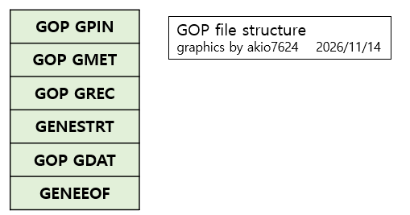
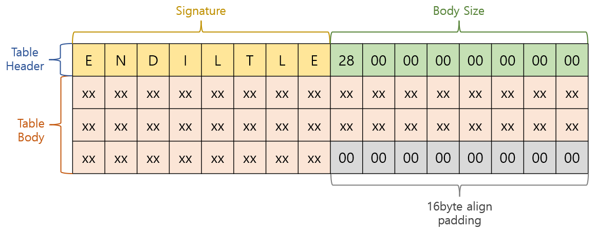

# GOP 파일

## 개요
Artdink 사의 전용 포맷으로 보이는 gop 파일의 바이너리 파일 내부 구조를 분석하여 정리한 문서이다.
파일 분석에는 사람이 직접 관찰하여 파악한 규칙성과 AI의 도움을 받아 찾아낸 패턴을 바탕으로 실제 몇 개의 게임 파일 샘플에 대해 직접 검토하는 방식을 사용하였다.

## 이름의 유래
알 수 없음

## 대략적인 구조

스프레드시트 파일에 메타데이터를 더하여 바이너리로 만든 파일로 볼 수 있다. 

## 상세 구조
* 각 필드명은 실제 이름이 알려진 정보가 없기 때문에 임의로 적절히 붙였다.
* 각 영역의 분류 및 명칭 또한 편의상 임의로 적절히 붙였다.
* 이 레포지토리에서는 이 문서에서 정의한 이름을 기준으로 사용한다.

아래 설명에는 `n바이트에 맞춰 정렬된다`라는 표현이 자주 등장한다.
이건 데이터가 끝나는 지점의 오프셋 x가 **x 이상이면서 가장 가까운 n의 배수**가 되도록 남은 공간을 0으로 패딩한다는 의미이다. (단, 데이터가 끝나는 지점의 오프셋 x가 이미 **n의 배수**이면 패딩을 하지 않는다)
데이터의 시작점은 파일의 처음일 수도 있고, 파일 중간의 특정 지점일 수도 있지만 두 경우 모두 시작점은 16의 배수이므로 단순히 파일 전역 오프셋을 기준으로 패딩을 계산해도 문제없다.

* 16바이트에 맞춰 정렬하는데 데이터가 0xC에서 끝났을 때 -> 남은 4바이트를 0으로 채운다.
* 512바이트에 맞춰 정렬하는데 데이터가 0x54DC에서 끝났을 때 -> 남은 292바이트를 0으로 채운다.

또한 아래와 같은 구조를 `테이블`이라고 부르겠다.

테이블은 16바이트의 `Table Header`와 가변 길이의 `Table Body`로 이루어지며, `Table Body`는 없는 경우도 있다.
`signature`의 경우 ASCII 문자열이며, 만약 문자열의 길이가 `8` 미만인 경우 남은 바이트는 `0x0(null)`이 아닌 `0x20(space)`로 채워진다.
`TABLE_SIZE`의 경우 헤더 16바이트를 제외한 테이블의 나머지 영역의 크기(패딩이 있다면 패딩 크기도 포함)를 나타내는 `uint64` 타입 정수이며, `Table Body`가 없는 경우에는 `0`이다.
만약 테이블의 마지막 부분이 16바이트에 정렬되어 있지 않다면 `0`으로 채워 정렬한다. 일부 테이블은 마지막에 가변 길이 요소를 가지며, 이 요소 자체의 패딩에 의해 정렬된 경우에는 테이블을 추가로 정렬해 줄 필요는 없다.

## Tables
> [!NOTE]
> 만약 첫 테이블이 `ENDIBIGE`인 경우 빅엔디언으로 해석하지만 현재 해당 방식으로 작성된 파일은 확인되지 않았다.
> 별도 엔디안 테이블 없이 바로 `GOP GFIN` 테이블로 시작시 리틀 엔디안으로 해석한다.

### GOP GFIN
의미: `Gop File INformation`

|    이름    | 자료형 | 크기/길이 | 설명                                                                                      |
|:----------:|:------:|:---------:|:------------------------------------------------------------------------------------------|
| SIGNATURE  | char[] |     8     | 테이블 시그니처로, 항상 `GOP GFIN`이다.                                                   |
| TABLE_SIZE | uint64 |     8     | Body의 크기로, 항상 `16`이다.                                                             |
|  VERSION   | uint32 |     4     | 파일의 버전을 나타내는 값으로 추측되며, 항상 `2`이고, 다른 버전의 존재는 확인되지 않았다. |
| unknown_1  | uint32 |     4     | 용도 불명의 필드이며, 값은 항상 `1`이다.                                                  |
| unknown_2  | uint32 |     4     | 용도 불명의 필드이며, 값은 항상 `0`이다.                                                  |
| unknown_3  | uint32 |     4     | 용도 불명의 필드이며, 값은 항상 `0`이다.                                                  |

### GOP GMET
의미: `Gop METadata`

|    이름    |   자료형    | 크기/길이 | 설명                                                                                                                                      |
|:----------:|:-----------:|:---------:|:------------------------------------------------------------------------------------------------------------------------------------------|
| SIGNATURE  |   char[]    |     8     | 테이블 시그니처로, 항상 `GOP GMET`이다.                                                                                                   |
| TABLE_SIZE |   uint64    |     8     | Body의 크기로, 각 필드의 크기(바이트)를 아래 식에 넣어 계산할 수 있다. `align16(arrsize(NODE_LIST))`                                   |
| NODE_LIST  | GMET_NODE[] |     ?     | 트리 형태의 메타데이터 정보를 각 노드를 DFS 순서로 나열한 영역이다. 노드의 개수 정보가 없어 정확한 크기를 바로 알 수 있는 방법은 없다. |
|  GMET_PAD  |      -      |     -     | 테이블의 끝이 16바이트에 정렬되도록 나머지 공간을 `0`으로 패딩하는 부분이다                                                               |

게임과는 별로 관련없는 데이터가 대부분이며 주로 원본 파일의 정보 등이 기록되어 있다.

#### GMET_NODE
|    이름    |   자료형    | 크기/길이  | 설명                                                                                                      |
|:----------:|:-----------:|:----------:|:----------------------------------------------------------------------------------------------------------|
|  NAME_IDX  |   uint16    |     2      | 해당 노드의 이름의 `GENESTRT` 테이블 상 인덱스 번호이다.                                                  |
| ITEM_COUNT |   uint16    |     2      | 해당 노드가 포함하는 값 혹은 자식 노드의 개수이다. 값을 포함하는 리프노드인 경우 이 값은 항상 `1`이다. |
| ITEM_LIST  | GMET_ITEM[] | ITEM_COUNT | 해당 노드의 값 혹은 자식 노드 리스트이다.                                                                 |

#### GMET_ITEM
| 이름  | 자료형 | 크기/길이 | 설명                                                                                                                                                                                              |
|:-----:|:------:|:---------:|:--------------------------------------------------------------------------------------------------------------------------------------------------------------------------------------------------|
| KIND  | uint16 |     2     | 이 아이템이 값인지 자식 노드인지 구분하는 플래그 값 - `0`: 값 - `1`: 자식 노드                                                                                                              |
| VALUE | uint16 |     2     | `KIND` 값에 따라 다르게 해석해야한다. - `KIND=0`인 경우 `GENESTRT`의 문자열 번호이다. - `KIND=1`이면 자식 노드의 오프셋이며, `GOP GMET` 테이블의 Body 시작점을 기준으로 하는 오프셋 값이다. |

### GOP GREC
의미: `Gop RECord`

|     이름     |    자료형     |  크기/길이   | 설명                                                                                                                            |
|:------------:|:-------------:|:------------:|:--------------------------------------------------------------------------------------------------------------------------------|
|  SIGNATURE   |    char[]     |      8       | 테이블 시그니처로, 항상 `GOP GREC`이다.                                                                                         |
|  TABLE_SIZE  |    uint64     |      8       | Body의 크기로, 각 필드의 크기(바이트)를 아래 식에 넣어 계산할 수 있다. `align16(sizeof(COLUMN_COUNT) + (12 * COLUMN_COUNT))` |
| COLUMN_COUNT |    uint32     |      4       | 컬럼(열) 개수로, `COLUMN_LIST`의 아이템 개수와 동일하다.                                                                        |
| COLUMN_LIST  | GREC_COLUMN[] | COLUMN_COUNT | 각 컬럼 정보의 나열이다.                                                                                                        |
|   GREC_PAD   |       -       |      -       | 테이블의 끝이 16바이트에 정렬되도록 나머지 공간을 `0`으로 패딩하는 부분이다                                                     |

#### GREC_COLUMN
|   이름    | 자료형 | 크기/길이 | 설명                                                                                                                                                                 |
|:---------:|:------:|:---------:|:---------------------------------------------------------------------------------------------------------------------------------------------------------------------|
|   TYPE    | uint32 |     4     | 컬럼 값의 자료형이다. 각 번호별 자료형 및 크기는 아래 별도의 표를 참조할것.                                                                                       |
|  OFFSET   | uint32 |     4     | 각 레코드에대해 레코드의 시작점을 기준으로 하는 현재 컬럼의 데이터의 시작 지점의 오프셋이다.                                                                         |
| NAME_IDX  | uint16 |     2     | 컬럼 이름의 `NAME_IDX`이다.                                                                                                                                          |
| LANG_FLAG | uint16 |     2     | 언어별로 다른 값을 가지는 열인지 여부를 지정하는 플래그 값이다. - `0`: 다른 언어 미지원 - `1`: 다른 언어의 테이블이 로드되어 있다면 해당 언어로 대체 표시 가능 |

#### TYPE 테이블
|   TYPE    | 자료형 이름 | 크기 | 저장 형식 | 비고                                             |
|:---------:|:------------|:----:|:----------|:-------------------------------------------------|
| `0`, `1`  | ?           |  ?   | ?         | 알 수 없음                                       |
|    `2`    | Enum        |  4   | int32     |                                                  |
|    `3`    | Int8        |  1   | int8      |                                                  |
|    `4`    | Int16       |  2   | int16     |                                                  |
|    `5`    | Int32       |  4   | int32     |                                                  |
|    `6`    | Int64       |  8   | int64     | 확실하지 않음                                    |
|    `7`    | UInt8       |  1   | uint8     |                                                  |
|    `8`    | UInt16      |  2   | uint16    |                                                  |
|    `9`    | UInt32      |  4   | uint32    |                                                  |
|   `10`    | UInt64      |  8   | uint64    | 확실하지 않음                                    |
|   `11`    | Float32     |  4   | float     |                                                  |
|   `12`    | Float64     |  8   | double    | 확실하지 않음                                    |
|   `13`    | bool        |  1   | uint8     | `0` 또는 `1`                                     |
|   `14`    | RecId       |  4   | uint32    | `GENESTRT`의 `NAME_IDX` 행을 구분하는 고유 키 |
|   `15`    | String      |  4   | uint32    | `GENESTRT`의 `NAME_IDX`                          |
| `16`-`21` | ?           |  ?   | ?         | 알 수 없음                                       |
|   `22`    | FRgba       |  16  | float[4]  |                                                  |
|   `23`    | FRgb        |  12  | float[3]  |                                                  |
|   `24`    | Rgba        |  4   | uint8[4]  |                                                  |
|   `25`    | Rgb         |  3   | uint8[3]  | R, G, B 순서                                     |
|   `26`    | Vector2     |  8   | float[2]  | 확실하지 않음                                    |
|   `27`    | Vector3     |  12  | float[3]  |                                                  |
|   `28`    | Vector4     |  16  | float[4]  | 확실하지 않음                                    |
|   `29`    | IVector2    |  8   | int32[2]  |                                                  |
|   `30`    | IVector3    |  12  | int32[3]  | 확실하지 않음                                    |
|   `31`    | IVector4    |  16  | int32[4]  |                                                  |
* `14`, `15`의 경우 음수면 `null`로 간주한다.

### GENESTRT
의미: `GENEral STRing Table`

|        이름         |  자료형  |    크기/길이     | 설명                                                                                                                                                                                                               |
|:-------------------:|:--------:|:----------------:|:-------------------------------------------------------------------------------------------------------------------------------------------------------------------------------------------------------------------|
|      SIGNATURE      |  char[]  |        8         | 테이블 시그니처로, 항상 `GENESTRT`이다.                                                                                                                                                                            |
|     TABLE_SIZE      |  uint64  |        8         | Body의 크기로, 각 필드의 크기(바이트)를 아래 식에 넣어 계산할 수 있다. `align16(align16(STRING_COUNT + 1) + arrsize_byte(STRING_LIST))` (`arrsize_byte(STRING_LIST)`는 `STRING_LIST` 전체의 바이트 크기이다) |
|    STRING_COUNT     |  uint32  |        4         | `STRING_LIST`가 포함하는 문자열의 개수이다.                                                                                                                                                                        |
| STRING_OFS_LIST_OFS |  uint32  |        4         | 테이블 Body를 기준점으로 하는 `STRING_OFS_LIST` 필드의 시작 오프셋이다. `STRING_COUNT`, `STRING_OFS_LIST_OFS`, `STRING_LIST_OFS`, `TABLE_SIZE_2` 필드는 모두 고정 길이이므로 이 필드의 값은 항상 `16`이다.      |
|   STRING_LIST_OFS   |  uint32  |        4         | 테이블 Body를 기준점으로 하는 `STRING_LIST` 필드의 시작 오프셋이다. `STRING_OFS_LIST`와 `STRING_OFS_LIST_PAD`를 건너뛴 위치이다. 계산: `align16(16 + (4 * (STRING_COUNT+1)))`                                |
|    TABLE_SIZE_2     |  uint32  |        4         | `TABLE_SIZE`와 동일한 값을 가진다. 실제로 사용되는 필드는 아닌 것으로 보이며 다만 값만 동일하게 맞춰두면 될 것 같다.                                                                                            |
|   STRING_OFS_LIST   | uint32[] | STRING_COUNT + 1 | `i`번째 문자열의 위치를 `STRING_LIST`의 시작점을 기준으로 몇 바이트 떨어진 곳에 있는지 나타내는 오프셋의 리스트이다. `STRING_LIST`의 배열 인덱스가 **아님**에 주의한다.                                         |
| STRING_OFS_LIST_PAD |    -     |        -         | `STRING_OFS_LIST`의 끝이 16바이트에 정렬되도록 나머지 공간을 `0`으로 패딩하는 부분이다.                                                                                                                            |
|     STRING_LIST     | string[] |   STRING_COUNT   | `null`로 끝나는 UTF-8 문자열들의 나열이다.                                                                                                                                                                         |
|   STRING_LIST_PAD   |    -     |        -         | 테이블의 끝(`STRING_LIST`의 끝)이 16바이트에 정렬되도록 나머지 공간을 `0`으로 패딩하는 부분이다.                                                                                                                   |

> [!NOTE]
> `APK`와 달리 `STRING_OFS_LIST`의 크기는 `STRING_COUNT + 1`이다.
> 추가된 마지막 항목에는 마지막 원소 다음에 가상의 원소가 있다 가정할 때, 그 원소의 오프셋이 들어간다.
> 간단히 말하면 `STRING_LIST`의 크기값이 기본적인 `STRING_OFS_LIST` 원소 뒤에 추가된다

문자열은 아래와 같은 순서로 정렬된다.
* 빈 문자열
* 각 컬럼의 이름을 `GREC.COLUMN_LIST`의 순서대로 나열
* 각 행에 대해 셀의 `TYPE`이 `14`, `15`인 셀의 문자열을 열 순서대로 나열한다.
* 메타데이터의 문자열을 노드 순서대로 노드 이름을 먼저 넣고 그 노드의 값을 차례로 나열한다.

다만 앞에서 이미 추가된 문자열이라면 중복하지 않고 건너뛴다.

### GOP GDAT
의미: `Gop DATa`

|      이름       |  자료형  |  크기/길이   | 설명                                                                                                                                                                                                                                              |
|:---------------:|:--------:|:------------:|:--------------------------------------------------------------------------------------------------------------------------------------------------------------------------------------------------------------------------------------------------|
|    SIGNATURE    |  char[]  |      8       | 테이블 시그니처로, 항상 `GOP GDAT`이다.                                                                                                                                                                                                           |
|   TABLE_SIZE    |  uint64  |      8       | Body의 크기로, 각 필드의 크기(바이트)를 아래 식에 넣어 계산할 수 있다. `align16(sizeof(RECORD_SIZE) + sizeof(RECORD_COUNT) + sizeof(INDEX_LIST_OFS) + sizeof(RECORD_LIST_OFS) + align16(arrsize(INDEX_LIST)) + align16(arrsize(RECORD_LIST)))` |
|   RECORD_SIZE   |  uint32  |      4       | 레코드 하나의 크기로 항상 4의 배수여야한다.                                                                                                                                                                                                       |
|  RECORD_COUNT   |  uint32  |      4       | 레코드의 개수이다.                                                                                                                                                                                                                                |
| INDEX_LIST_OFS  |  uint32  |      4       | 테이블 Body를 기준점으로 하는 `INDEX_LIST` 필드의 시작 오프셋이다.                                                                                                                                                                                |
| RECORD_LIST_OFS |  uint32  |      4       | 테이블 Body를 기준점으로 하는 `RECORD_LIST` 필드의 시작 오프셋이다.                                                                                                                                                                               |
|   INDEX_LIST    | uint32[] | RECORD_COUNT | 각 레코드의 `SelfId` 문자열의 바이트 기준으로 오름차순 정렬 후 그 순서대로 행의 번호를 나열한 부분이다.                                                                                                                                           |
| INDEX_LIST_PAD  |    ?     |      ?       | `INDEX_LIST`의 끝이 16바이트에 정렬되도록 나머지 공간을 `0`으로 패딩하는 부분이다.                                                                                                                                                                |
|   RECORD_LIST   | RECORD[] | RECORD_COUNT | 레코드들의 나열이다. 나열되는 순서가 곧 행 번호이다.                                                                                                                                                                                              |
|    GDAT_PAD     |    ?     |      ?       | 테이블의 끝(`RECORD_LIST`의 끝)의 끝이 16바이트에 정렬되도록 나머지 공간을 `0`으로 패딩하는 부분이다.                                                                                                                                             |

#### RECORD
|   이름   | 자료형 | 크기/길이 | 설명                                                                                                                                                   |
|:--------:|:------:|:---------:|:-------------------------------------------------------------------------------------------------------------------------------------------------------|
|  SelfId  | uint32 |     4     | 각 레코드(행)을 구분하는 주 키(PK)이다. 타입 14(RecId)이며, 문자열이므로 `GENESTRT`를 참조하는 인덱스 정수로 저장된다.                              |
| 각 값... |   ?    |     ?     | SelfId 이후로는 GOP 파일에 선언된 컬럼에 따라 필드 개수 및 크기가 가변적으로 달라진다. 다만 하나의 GOP 파일 안에서는 모든 레코드의 구조는 동일하다. |

### GENEEOF
의미: `GENEral End Of File`

|    이름    | 자료형 | 크기/길이 | 설명                                                                                                                      |
|:----------:|:------:|:---------:|:--------------------------------------------------------------------------------------------------------------------------|
| SIGNATURE  | char[] |     8     | 테이블 시그니처로, 항상 `GENEEOF `이다. 마지막 글자는 null이 아닌 **공백**이다.  파일이 끝났음을 알리는 빈 테이블이다. |
| TABLE_SIZE | uint64 |     8     | 이 테이블은 Body를 가지지 않으므로 항상 `0`이다.                                                                          |
